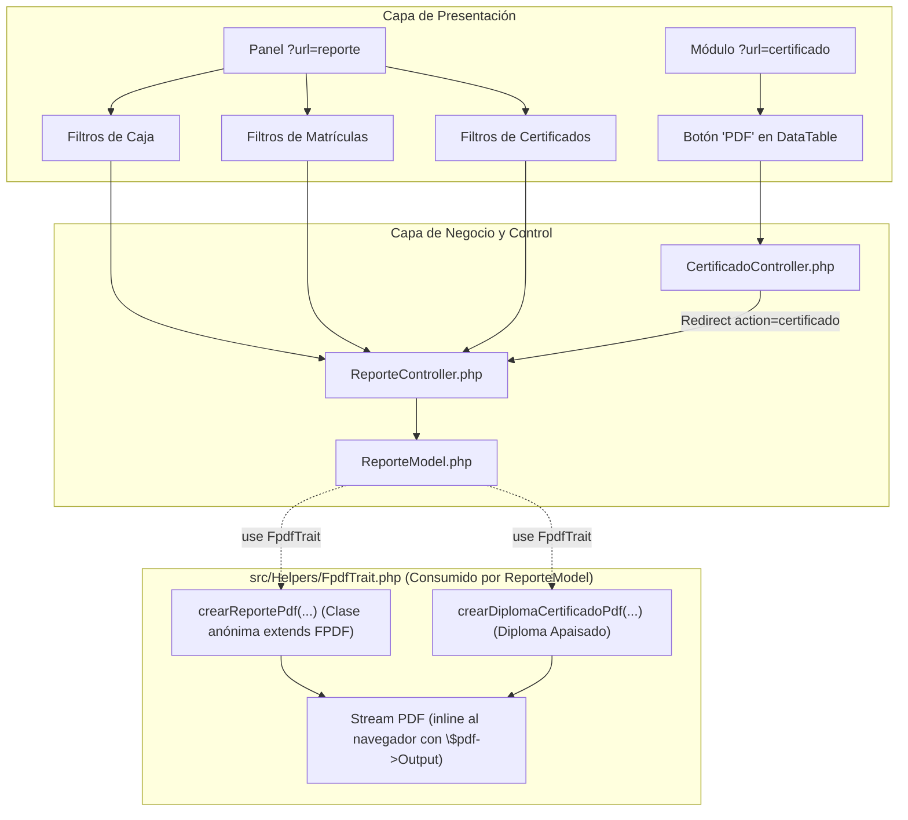

# 📊 Documentación Técnica: Motor de Reportes y Certificados en PDF (FPDF)
**Proyecto:** DS Beauty Academy  
**Módulo:** Reportes Oficiales, Auditoría y Acreditaciones  
**Biblioteca:** FPDF 1.8.2 (`setasign/fpdf`)  
**Arquitectura:** PHP 8.2 (PDO) / MVC / FrontController / Traits en Helpers / FPDF / Dark Luxury UI  
**Fecha:** Noviembre 2026  

---

## 1. Visión General y Cumplimiento de Restricción Académica

El módulo de reportes permite a la directiva y al cuerpo docente de **DS Beauty Academy** auditar las operaciones financieras de la academia, supervisar el aforo de los talleres prácticos y expedir diplomas/certificados oficiales en formato físico o digital descargable.

Se utilizó la biblioteca **FPDF** por su ligereza, control milimétrico del layout (coordenadas X/Y) y cero dependencias pesadas de navegadores externos, adaptando la tipografía y los elementos gráficos a la paleta institucional (**Glow Pink**: `#E83382`, **Dark Navy**: `#18181c`).

### 🏛️ Cumplimiento de Restricciones Universitarias (UML / Diagrama de Clases)
Por especificación de la universidad evaluadora:
1. **No se permiten clases independientes** en el proyecto salvo:
   - Clases de Modelos (`src/Models/*Model.php`) que extienden `DBConnect`.
   - El enrutador central `FrontController` (`src/Controllers/FrontController.php`).
2. **Uso estricto de Traits en Helpers:**
   Toda funcionalidad auxiliar o transversal ubicada en `src/Helpers/` debe estructurarse como un **Trait** de PHP (`trait FpdfTrait`, `trait CorreoTrait`, `trait ApiResponse`, `trait Validations`).
3. **Generación FPDF vía Trait y Clases Anónimas:**
   En lugar de crear clases nombradas auxiliares (`FpdfReport` o `FpdfCertificado`), la lógica de formateo y maquetación PDF reside dentro de `FpdfTrait.php`, el cual es consumido por [`ReporteModel`](file:///opt/lampp/htdocs/proyectos/ds-beauty-academy/src/Models/ReporteModel.php) (`use FpdfTrait;`). Para personalizar la cabecera institucional y el pie de página numerado de FPDF, se aprovecha una **clase anónima interna** (`new class(...) extends \FPDF`), cumpliendo al 100% con las restricciones formales del diagrama de clases.



---

## 2. Inventario de Componentes Desarrollados

```text
ds-beauty-academy/
├── composer.json                         <- Dependencia agregada: "setasign/fpdf": "^1.8"
├── src/
│   ├── Helpers/
│   │   ├── FpdfTrait.php                 <- Trait con constructores PDF y clase anónima institucional
│   │   ├── CorreoTrait.php               <- Trait para despacho de correos SMTP con PHPMailer
│   │   ├── ApiResponse.php               <- Trait para respuestas JSON estandarizadas
│   │   └── Validations.php               <- Trait para sanitización y validaciones regex
│   ├── Models/
│   │   └── ReporteModel.php              <- Modelo que usa FpdfTrait y extrae datos de BD
│   ├── Controllers/
│   │   ├── ReporteController.php         <- Enrutador de reportes PDF y renderizador de la vista
│   │   └── CertificadoController.php     <- Adaptación para redirección y descarga de certificados PDF
│   ├── views/
│   │   └── reporte/
│   │       └── reporte.php               <- Centro de control con tarjetas interactivas y filtros
│   └── assets/js/certificado/
│       └── certificadoDataTable.js       <- Botón 'PDF' interactivo conectado al generador dinámico
```

---

## 3. Tipos de Reportes Implementados

### 3.1. Reporte Financiero de Caja y Conciliación Bancaria
* **Ruta de Despacho:** `?url=reporte&action=pdf&tipo=caja`
* **Orientación:** Vertical (`Portrait`, Carta).
* **Parámetros de Filtrado:**
  * `fecha_desde` y `fecha_hasta`: Rango de fechas de pago.
  * `id_banco`: Banco receptor de la transferencia o pago móvil.
  * `estatus_comprobante`: `Verificado`, `Pendiente` o `Rechazado`.
* **Métricas Clave del Encabezado (KPIs):**
  * Monto total recaudado ($).
  * Conteo de pagos verificados.
  * Conteo de pagos en revisión (pendientes).
  * Conteo de pagos rechazados.
* **Columnas del Reporte:** Referencia bancaria, Nombre del estudiante, Curso inscrito, Banco emisor, Monto ($), Fecha de acreditación y Estado.

---

### 3.2. Reporte Académico de Matrículas y Aforo
* **Ruta de Despacho:** `?url=reporte&action=pdf&tipo=matriculas`
* **Orientación:** Apaisada (`Landscape`, Carta).
* **Parámetros de Filtrado:**
  * `id_curso`: Selección de curso específico o catálogo completo.
  * `estatus_cupo`: `Confirmado`, `Reservado` o `Cancelado`.
  * `estatus_pago`: `Solvente` o `Deudora`.
* **Métricas Clave del Encabezado:**
  * Total de alumnas inscritas.
  * Alumnas solventes vs deudoras.
  * Cupos confirmados vs en reserva.
* **Columnas del Reporte:** ID Matrícula, Nombre completo, Cédula, Teléfono de contacto, Nombre del curso, Docente asignado, Precio pactado ($), Estatus de pago y Estatus del cupo.

---

### 3.3. Historial de Certificados y Logros
* **Ruta de Despacho:** `?url=reporte&action=pdf&tipo=certificados`
* **Orientación:** Vertical (`Portrait`, Carta).
* **Parámetros de Filtrado:**
  * `id_curso`: Filtrado por pensum académico.
  * `estatus_certificado`: `Emitido` o `Pendiente de Emisión`.
* **Columnas del Reporte:** ID de certificado, Estudiante, Cédula, Curso, Categoría y Estado de la certificación.

---

### 3.4. Diploma / Certificado Individual de Aprobación
* **Ruta de Despacho:** `?url=reporte&action=certificado&id=[ID_CERTIFICADO]`
* **Orientación:** Apaisada (`Landscape`, Carta).
* **Características de Diseño:**
  * **Marco Ornamental Perimetral:** Doble recuadro con filete exterior en gris grafito `#23232d` y filete central en acento Glow Pink `#E83382`, con esquineros rellenos.
  * **Titularidad Institucional:** Membrete de la República y nombre de la academia en tipografía destacada.
  * **Datos del Egresado:** Nombre en gran formato (`20pt`) en color corporativo, cédula de identidad y título del curso entrecomillado.
  * **Fechas y Lugar:** Redacción formal en español con día, mes en texto y año.
  * **Espacio de Firmas:** Doble línea para la *Docente / Máster Certificada* y la *Dirección Académica General*.
  * **Trazabilidad y Validez:** Generación automática del **Serial Único de Verificación**:
    $$\text{Serial} = \text{DSBA-} \langle \text{Año} \rangle \text{-CERT-} \langle \text{ID con 5 dígitos} \rangle$$
    *(Ejemplo: `DSBA-2026-CERT-00001`)*.

---

## 4. Desglose de Métodos en [`FpdfTrait.php`](file:///opt/lampp/htdocs/proyectos/ds-beauty-academy/src/Helpers/FpdfTrait.php)

El trait `FpdfTrait` provee tres métodos principales para ser utilizados por cualquier modelo (especialmente `ReporteModel`):

1. **`utfPdf(string $texto): string`**
   - Transcodifica cadenas UTF-8 a `windows-1252` con transliteración mediante `iconv`, asegurando la correcta impresión de tildes, diéresis, eñes y signos interrogativos (`¿`, `¡`) sin distorsionar la codificación de FPDF.

2. **`crearReportePdf(string $orientacion = 'P', string $titulo = 'Reporte Oficial', string $subtitulo = '', string $filtros = '')`**
   - Instancia y retorna una clase anónima que extiende de `\FPDF`.
   - Sobrescribe el método `Header()` para renderizar la franja Glow Pink corporativa, títulos jerárquicos, metadatos temporales de auditoría y línea divisoria.
   - Sobrescribe `Footer()` con paginación dinámica (`Página X de {nb}`).
   - Provee los métodos utilitarios `renderTableHeader(...)` y `renderTableRow(...)` para renderizar tablas tipo cebra de forma automatizada y estilizada.

3. **`crearDiplomaCertificadoPdf(array $datos)`**
   - Instancia una clase base `\FPDF('L', 'mm', 'Letter')`.
   - Dibuja el marco decorativo perimetral con doble borde y esquinas sólidas.
   - Posiciona el membrete, nombre de la alumna, cédula, curso, cuerpo de acreditación, fecha extendida, firmas de docentes y el serial único de validación.

---

## 5. Pruebas y Verificación

1. **Pruebas de Aislamiento Unitario (CLI LAMPP):**
   - Reporte de Caja: 38 comprobantes procesados con $3,340.00 en total recaudado.
   - Reporte de Matrículas: 42 registros generados en formato horizontal apaisado.
   - Reporte de Certificados: 10 registros listados con filtros aplicados.
   - Certificado Individual: Generación exitosa del certificado #1 correspondiente a la estudiante *Camila Herrera* con serial `DSBA-2026-CERT-00001`.
2. **Pruebas de Integración Web en LAMPP (`localhost:8080`):**
   - Vista de Reportes: `?url=reporte` responde `200 OK` con sesión administrativa activa.
   - Descarga de Reportes PDF: Los enlaces y botones con `target="_blank"` abren el flujo nativo de visualización en el navegador (`Content-Type: application/pdf; filename="Reporte_..."`).
   - Botón PDF en Certificados: Al hacer clic en el botón `PDF` de la tabla de certificados en `?url=certificado`, abre directamente el certificado generado dinámicamente con FPDF.
3. **Auditoría de Clases del Proyecto:**
   - Se ejecutó `grep -rn "^class " src/`, comprobando que no existe ninguna clase independiente fuera de `FrontController` y los modelos `*Model`. Todos los helpers son estrictamente `trait`.
