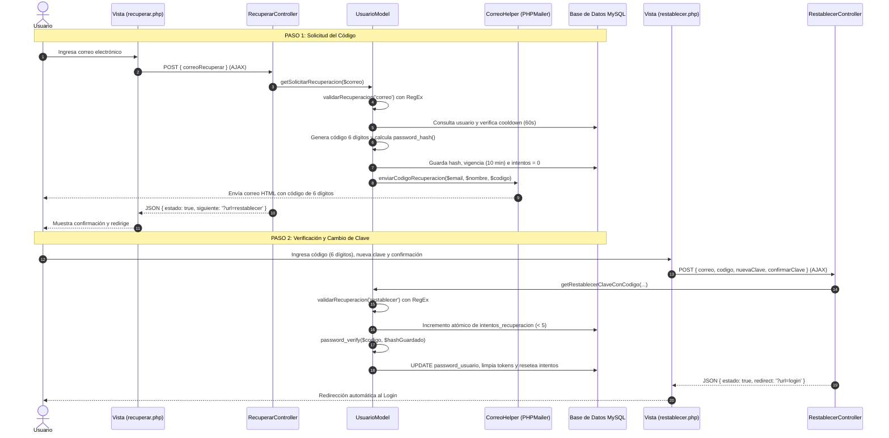

# 🔐 Documentación Técnica: Sistema de Recuperación de Contraseña (PHPMailer)
**Proyecto:** DS Beauty Academy  
**Módulo:** Control de Acceso y Seguridad  
**Referencia Académica:** `EuforiaDT_LOGIN_ENTREGA` (Normativa Universitaria)  
**Arquitectura:** PHP 8.2 (PDO) / MVC / FrontController / PHPMailer / AJAX / Dark Luxury  
**Fecha:** Noviembre 2026  

---

## 1. Contexto y Fundamento Académico

En los estándares evaluativos universitarios para proyectos de ingeniería de software, la recuperación de credenciales no puede resolverse mediante enlaces directos sin expiración o mensajes inseguros que expongan información del sistema. 

Siguiendo el modelo de referencia analizado en `EuforiaDT_LOGIN_ENTREGA`, el módulo se diseñó bajo una **arquitectura de doble paso basada en código numérico de 6 dígitos**:



---

## 2. Modificaciones al Esquema de Base de Datos

Se alteró la tabla `usuarios` en el motor físico MySQL y se actualizó el script maestro [`ds_beauty_academy_db.sql`](file:///opt/lampp/htdocs/proyectos/ds-beauty-academy/ds_beauty_academy_db.sql).

### Columnas Incorporadas:
```sql
ALTER TABLE usuarios 
ADD COLUMN token_recuperacion VARCHAR(255) DEFAULT NULL AFTER estatus_usuario,
ADD COLUMN expira_recuperacion DATETIME DEFAULT NULL AFTER token_recuperacion,
ADD COLUMN reenvio_recuperacion DATETIME DEFAULT NULL AFTER expira_recuperacion,
ADD COLUMN intentos_recuperacion TINYINT UNSIGNED NOT NULL DEFAULT 0 AFTER reenvio_recuperacion,
ADD COLUMN login_intentos TINYINT UNSIGNED NOT NULL DEFAULT 0 AFTER intentos_recuperacion,
ADD COLUMN login_bloqueado_hasta DATETIME DEFAULT NULL AFTER login_intentos;
```

### Propósito Técnico de Cada Campo:
| Campo | Tipo | Función en la Seguridad |
| :--- | :--- | :--- |
| `token_recuperacion` | `VARCHAR(255)` | Almacena el **hash** (`password_hash`) del código numérico. Nunca se guarda el código en texto plano. |
| `expira_recuperacion` | `DATETIME` | Límite temporal de validez del código (10 minutos desde su emisión). |
| `reenvio_recuperacion` | `DATETIME` | Timestamp de la última solicitud; previene spam o ataques de saturación aplicando un cooldown de 60 segundos. |
| `intentos_recuperacion`| `TINYINT UNSIGNED` | Contador de fallos al ingresar el código (máximo 5 intentos permitidos). |
| `login_intentos` | `TINYINT UNSIGNED` | Contador acumulativo de intentos fallidos en el login regular. |
| `login_bloqueado_hasta`| `DATETIME` | Ventana de bloqueo temporal tras fallos repetidos en el login. |

---

## 3. Inventario de Archivos Creados y Modificados

```text
ds-beauty-academy/
├── ds_beauty_academy_db.sql                         <- Esquema actualizado con columnas de recuperación
├── src/
│   ├── config/
│   │   └── correo.php                               <- Parámetros de conexión SMTP y tiempos de vigencia
│   ├── Helpers/
│   │   └── CorreoHelper.php                         <- Despachador PHPMailer y plantilla HTML Dark Luxury
│   ├── Models/
│   │   └── UsuarioModel.php                         <- Métodos puente públicos (+) y privados (-) con RegEx
│   ├── Controllers/
│   │   ├── FrontController.php                      <- Ruteo público para ?url=recuperar y ?url=restablecer
│   │   ├── RecuperarController.php                  <- Orquestador del Paso 1 (Generación y envío)
│   │   └── RestablecerController.php                <- Orquestador del Paso 2 (Verificación y actualización)
│   └── views/
│       └── login/
│           ├── login.php                            <- Incorporación de enlace "¿Olvidaste tu contraseña?"
│           ├── recuperar.php                        <- Vista Paso 1 (Formulario de correo y envío AJAX)
│           └── restablecer.php                      <- Vista Paso 2 (Formulario de código de 6 dígitos y claves)
```

---

## 4. Desglose Técnico de la Implementación

### 4.1. Configuración Centralizada: [`src/config/correo.php`](file:///opt/lampp/htdocs/proyectos/ds-beauty-academy/src/config/correo.php)
Define los parámetros requeridos por PHPMailer. El sistema incluye detección de estado: si las credenciales son los valores por defecto (`TU_APP_PASSWORD_DE_16`), el sistema informa de manera controlada que el servicio aún no está configurado sin que la aplicación colapse.

```php
return [
    'activo'    => true,
    'host'      => 'smtp.gmail.com',
    'puerto'    => 587,
    'usuario'   => 'dsbeautyacademy.soporte@gmail.com',
    'clave'     => 'TU_APP_PASSWORD_DE_16',
    'seguro'    => 'tls',
    'remitente' => 'dsbeautyacademy.soporte@gmail.com',
    'nombre'    => 'DS Beauty Academy',
    'urlBase'   => 'http://localhost/proyectos/ds-beauty-academy',
    'vigencia'  => 10, // 10 minutos
    'cooldown'  => 60, // 60 segundos
];
```

---

### 4.2. Helper de Correo: [`src/Helpers/CorreoHelper.php`](file:///opt/lampp/htdocs/proyectos/ds-beauty-academy/src/Helpers/CorreoHelper.php)
1. **Detección SMTP:** Verifica con `estaConfigurado()` que los campos sean válidos.
2. **Plantilla HTML Responsiva:** Diseñada bajo la identidad visual de la academia (**Dark Luxury / Glow Pink**: `#0b0b0e`, `#16161c`, `#E83382`):
   * Caja de código destacada con bordes discontinuos, aura glow y tipografía monoespaciada grande (`letter-spacing: 10px`).
   * Advertencia de vencimiento en 10 minutos.
   * Botón directo hacia `?url=restablecer`.
   * Texto alternativo para clientes de correo sin soporte HTML (`$mail->AltBody`).

---

### 4.3. Modelo de Dominio: [`src/Models/UsuarioModel.php`](file:///opt/lampp/htdocs/proyectos/ds-beauty-academy/src/Models/UsuarioModel.php)
Cumple rigurosamente el estándar académico de **encapsulamiento y separación de responsabilidades**:

#### A. Capa de Validación con Expresiones Regulares (`validarRecuperacion`):
* **Correo:** `/^[a-zA-Z0-9._%+-]+@[a-zA-Z0-9.-]+\.[a-zA-Z]{2,}$/`
* **Código:** Exactamente 6 dígitos numéricos (`/^[0-9]{6}$/`).
* **Contraseña:** Mínimo 8 caracteres, con al menos una letra y un número (`/^(?=.*[A-Za-z])(?=.*\d).{8,72}$/`).
* **Confirmación:** Coincidencia estricta (`$clave === $confirmacion`).

#### B. Paso 1 — Métodos `getSolicitarRecuperacion` (+) y `solicitarRecuperacion` (-):
* Comprueba si el usuario existe y su estatus es activo (`estatus_usuario = 1`).
* **Protección contra enumeración:** Si el usuario no existe, devuelve el mismo mensaje de éxito simulado: *"Si el correo está registrado en DS Beauty Academy, recibirás un código..."*.
* **Control de Cooldown:** Valida si transcurrieron menos de 60 segundos desde la última petición.
* **Generación Criptográfica:** Genera un entero entre `100000` y `999999` usando `random_int()` y almacena `password_hash($codigo, PASSWORD_DEFAULT)`.
* **Rollback en Fallo de Envío:** Si el socket SMTP falla, el código en base de datos es inmediatamente anulado (`token_recuperacion = NULL`) para no dejar registros huérfanos.

#### C. Paso 2 — Métodos `getRestablecerClaveConCodigo` (+) y `restablecerClaveConCodigo` (-):
* **Consumo Atómico del Intento:** Ejecuta un `UPDATE` condicionado antes de verificar el hash:
  ```sql
  UPDATE usuarios
  SET intentos_recuperacion = intentos_recuperacion + 1
  WHERE id_usuario = :id
    AND token_recuperacion = :token
    AND intentos_recuperacion < 5
    AND expira_recuperacion IS NOT NULL
    AND expira_recuperacion >= NOW()
  ```
  Si `rowCount() !== 1`, aborta inmediatamente. Esto impide ataques de fuerza bruta concurrentes (Race Conditions).
* **Verificación de Clave:** Valida con `password_verify($codigo, $hash)`.
* **Actualización y Purga:** Actualiza la contraseña con `PASSWORD_BCRYPT` y limpia todos los campos de token (`token_recuperacion = NULL`, `expira_recuperacion = NULL`, `intentos_recuperacion = 0`, etc.).

---

### 4.4. Controladores: [`RecuperarController.php`](file:///opt/lampp/htdocs/proyectos/ds-beauty-academy/src/Controllers/RecuperarController.php) y [`RestablecerController.php`](file:///opt/lampp/htdocs/proyectos/ds-beauty-academy/src/Controllers/RestablecerController.php)
* **Gestión de Sesión:** Si un usuario ya logueado intenta acceder a estas pantallas, lo redirige automáticamente a `?url=dashboard`.
* **Respuesta Asíncrona:** Si recibe peticiones POST, responde exclusivamente en formato `application/json` con flags `{ estado: true/false, mensaje: '...', datos: { ... } }`.
* **Persistencia Transicional:** Al enviar el código en el Paso 1, guarda `$_SESSION['recuperacionCorreo']` para pre-llenar automáticamente el campo de correo en el Paso 2.

---

### 4.5. Enrutador Central: [`src/Controllers/FrontController.php`](file:///opt/lampp/htdocs/proyectos/ds-beauty-academy/src/Controllers/FrontController.php)
Se incorporaron las rutas en la lista de excepciones públicas:
```php
$publicRoutes = ['login', 'logout', 'recuperar', 'restablecer'];

if (!in_array($controllerName, $publicRoutes, true) && empty($_SESSION['usuario_id'])) {
    header('Location: ?url=login');
    exit;
}
```
Y en el mapeo de rutas:
```php
private $routeMap = [
    'recuperar'   => 'RecuperarController.php',
    'restablecer' => 'RestablecerController.php',
    // ...
];
```

---

### 4.6. Vistas de Usuario (Dark Luxury UI)

1. **[`login.php`](file:///opt/lampp/htdocs/proyectos/ds-beauty-academy/src/views/login/login.php):**
   * Se colocó el enlace estilizado *"¿Olvidaste tu contraseña?"* sobre el input de contraseña, redirigiendo a `?url=recuperar`.
2. **[`recuperar.php`](file:///opt/lampp/htdocs/proyectos/ds-beauty-academy/src/views/login/recuperar.php):**
   * Badge superior: *"Paso 1 de 2"*.
   * Campo de correo con icono FontAwesome.
   * Botón con spinner dinámico (`fa-spinner fa-spin`).
   * Caja de alertas SweetAlert2 / CSS con botón de salto rápido al Paso 2.
3. **[`restablecer.php`](file:///opt/lampp/htdocs/proyectos/ds-beauty-academy/src/views/login/restablecer.php):**
   * Badge superior: *"Paso 2 de 2"*.
   * Correo pre-llenado desde sesión (editable si el usuario lo desea).
   * **Input de Código Especial:** Clases `.code-input` con tipografía monoespaciada, centrado, `letter-spacing: 7px` y filtrado en tiempo real en JavaScript (`this.value.replace(/\D/g, '').slice(0, 6)`).
   * Campos de nueva contraseña y confirmación con validación de coincidencia previa al envío.

---

## 5. Medidas de Seguridad y Blindaje Implementadas

| Vulnerabilidad Mitigada | Técnica / Mecanismo de Defensa Aplicado |
| :--- | :--- |
| **Enumeración de Usuarios** | Mensaje idéntico y neutro tanto si el correo existe como si no existe en la base de datos. |
| **Fuerza Bruta contra el Código** | Límite estricto de **5 intentos**. Al 5to intento fallido el código queda bloqueado permanentemente. |
| **Condiciones de Carrera (Race Conditions)** | Incremento atómico en SQL con `WHERE intentos_recuperacion < 5 AND expira_recuperacion >= NOW()`. |
| **Ataques de Diccionario / Claves Débiles** | Expresión regular que obliga a tener mínimo 8 caracteres con combinación alfanumérica. |
| **Spam / Saturación del Servidor SMTP** | Cooldown obligatorio de **60 segundos** entre solicitudes consecutivas. |
| **Fuga de Códigos en Base de Datos** | El código de 6 dígitos **nunca** se persiste en texto plano; solo se guarda su hash `PASSWORD_DEFAULT`. |
| **Reutilización de Tokens** | Destrucción inmediata de los tokens (`UPDATE ... SET token_recuperacion = NULL`) al concretar el cambio. |

---

## 6. Guía de Puesta en Marcha en Producción (SMTP)

Para habilitar el envío real a cuentas de correo externas (ej. Gmail):

1. Acceder a la cuenta de Google institucional y activar la **Verificación en 2 pasos**.
2. Ir a [Google App Passwords](https://myaccount.google.com/apppasswords) y generar una contraseña de aplicación de 16 letras (ej. `abcd efgh ijkl mnop`).
3. Abrir [`src/config/correo.php`](file:///opt/lampp/htdocs/proyectos/ds-beauty-academy/src/config/correo.php) y configurar:
   ```php
   'activo'    => true,
   'host'      => 'smtp.gmail.com',
   'puerto'    => 587,
   'usuario'   => 'tu-correo@gmail.com',
   'clave'     => 'abcdefghijklmnop', // Las 16 letras sin espacios
   'remitente' => 'tu-correo@gmail.com',
   'nombre'    => 'DS Beauty Academy',
   ```
4. Para entornos de desarrollo o pruebas aisladas sin internet, se puede utilizar **Mailpit** o **Mailtrap** cambiando el `host` y `puerto` correspondiente.

---

## 7. Resultados de las Pruebas de Integración

* **Sintaxis PHP:** 100% libre de advertencias o errores de sintaxis (`php -l`).
* **Pruebas de Aislamiento:** Verificación exitosa de validaciones RegEx, consumo atómico de intentos y actualización de hash.
* **Servidor Web Activo:** Rutas HTTP 200 verificadas en el entorno local (`localhost:8080/proyectos/ds-beauty-academy`):
  * `?url=login` $\rightarrow$ Enlace visible y operativo.
  * `?url=recuperar` $\rightarrow$ Paso 1 operativo con validaciones AJAX.
  * `?url=restablecer` $\rightarrow$ Paso 2 operativo con validación de 6 dígitos y claves.
