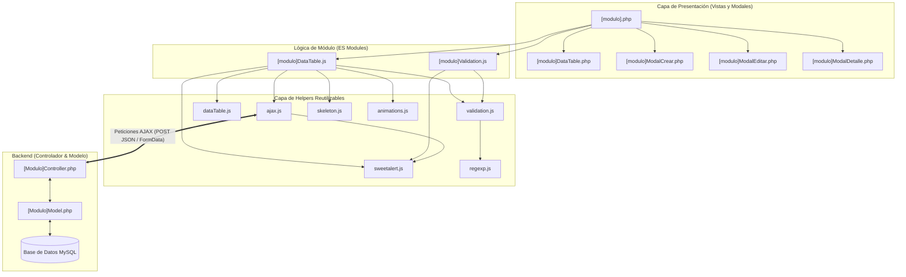

# 🏛️ Guía Maestra de Arquitectura Front-End y Migración Modular

Esta guía documenta la arquitectura frontend moderna implementada en **DS Beauty Academy**, inspirada en los patrones de diseño y helpers de **client-bruz-electiva**. Sirve como manual de referencia técnica para comprender su funcionamiento y replicarlo paso a paso en cualquier otro módulo o proyecto universitario/profesional.

---

## 1. Visión General y Filosofía de Diseño

El objetivo de esta arquitectura es transformar un sistema web tradicional basado en tablas HTML estáticas, recargas completas de pantalla y alertas nativas (`alert()` / `confirm()`), en una **aplicación web moderna tipo SPA (Single Page Application feel)** que destaca por:

1. **Cero recargas de página:** Toda la interacción CRUD (Crear, Leer, Actualizar, Eliminar) se realiza asíncronamente mediante peticiones AJAX y modales.
2. **Validaciones reactivas en tiempo real:** Los formularios se validan mientras el usuario escribe (evento `input`), dando feedback visual instantáneo (`is-valid` / `is-invalid`) y deshabilitando el botón de envío si existen errores.
3. **Alertas profesionales y temáticas:** Sustitución total de `alert()` y `confirm()` por **SweetAlert2** configurado con la paleta de colores del proyecto (**Dark Luxury / Glow Pink**: `#18181c`, `#E83382`, `#f3f3f5`).
4. **Tablas dinámicas avanzadas:** Migración a **DataTables 1.13+**, con búsqueda instantánea, paginación inteligente, ordenamiento multi-columna, idioma en español y renderizado seguro.
5. **Experiencia de usuario fluida (UX):** Uso de **Skeleton Loaders** (placeholders animados) y micro-interacciones visuales para evitar parpadeos y saltos de layout (*Cumulative Layout Shift*).
6. **Modularidad nativa ES6:** Código estructurado en módulos JavaScript independientes (`import` / `export`), reutilizando helpers y evitando variables globales dispersas.

---

## 2. Estructura de Directorios del Front-End

```text
src/
├── assets/
│   ├── linksFront.php                       <- Inclusión centralizada de CSS y JS globales
│   └── js/
│       ├── helpers/                         <- Capa transversal y reutilizable
│       │   ├── ajax.js                      <- Wrapper de peticiones asíncronas y control de errores
│       │   ├── sweetalert.js                <- Diálogos, toasts y loaders temáticos
│       │   ├── dataTable.js                 <- Factoría de DataTables y botones de acción
│       │   ├── regexp.js                    <- Catálogo de expresiones regulares
│       │   ├── validation.js                <- Lógica reactiva de validación de campos
│       │   ├── skeleton.js                  <- Control de skeleton loaders
│       │   └── animations.js                <- Micro-animaciones (fade, shake)
│       └── [modulo]/                        <- Lógica específica por entidad (ej: estudiante)
│           ├── [modulo]DataTable.js         <- Orquestación de la tabla, modales y llamadas AJAX
│           └── [modulo]Validation.js        <- Validaciones reactivas de los formularios
└── views/
    ├── styles.css                           <- Estilos globales (incluye tema oscuro de DataTables)
    └── [modulo]/                            <- Vistas PHP del módulo
        ├── [modulo].php                     <- Vista orquestadora principal
        └── components/
            ├── [modulo]DataTable.php        <- Estructura HTML de la tabla + Skeleton
            └── modales/
                ├── [modulo]ModalCrear.php   <- Formulario modal para registrar
                ├── [modulo]ModalEditar.php  <- Formulario modal para modificar
                └── [modulo]ModalDetalle.php <- Vista modal para consultar información
```

---

## 3. Diagrama de Arquitectura y Dependencias



---

## 4. Desglose Técnico de la Suite de Helpers

### 4.1. `linksFront.php`
Centraliza la inclusión de bibliotecas CDN y locales para evitar duplicar decenas de `<link>` y `<script>` en cada vista:
* **CSS:** Google Fonts Inter, FontAwesome 6, Bootstrap 5.3, DataTables Bootstrap 5, SweetAlert2, Animate.css y `styles.css`.
* **JS:** jQuery 3.7+, Bootstrap 5.3 Bundle, DataTables 1.13+ y SweetAlert2.

### 4.2. `sweetalert.js`
Abstrae la librería SweetAlert2 bajo el sistema visual **Dark Luxury**:
```javascript
import { showSuccess, showError, showConfirm, showToast, showLoading, closeLoading } from '../helpers/sweetalert.js';

// Diálogo de confirmación que devuelve una promesa booleana:
const confirmado = await showConfirm('¿Eliminar registro?', 'Esta acción no se puede deshacer.');
if (confirmado) {
    // Proceder
}

// Toast no invasivo en la esquina superior derecha:
showToast('Operación completada con éxito');

// Spinner mientras el servidor procesa:
showLoading('Guardando...', 'Por favor espere');
closeLoading();
```

### 4.3. `ajax.js`
Wrapper sobre `$.ajax` adaptado a las convenciones de los controladores:
* Detecta automáticamente si se envía `FormData` (con imágenes o archivos) o un objeto plano, asignando los `contentType` y `processData` correspondientes.
* Incorpora métodos semánticos para peticiones CRUD:
  - `getAll(url)`: Envía `{ buscarTodos: 'true' }`.
  - `getById(url, id)`: Envía `{ buscar: id }`.
  - `create(url, formData)`: Inyecta `{ guardar: 'true' }`.
  - `update(url, formData)`: Inyecta `{ actualizar: 'true' }`.
  - `remove(url, id)`: Envía `{ eliminar: id }`.
* **`executeAjax(promise, successMsg, onSuccess)`**: Ejecuta la promesa, analiza si la respuesta trae `code === 200 || code === 201 || status === 'success'`, muestra los mensajes y ejecuta el callback de éxito.

### 4.4. `dataTable.js`
Factoría para inicializar tablas de manera estandarizada:
* **`createDataTable(selector, url, columns, customConfig)`**:
  - Configura DataTables para consumir la API AJAX directamente (`dataSrc: 'data'`).
  - Traduce toda la interfaz al español (búsqueda, paginador, conteo de registros).
  - Adapta la estructura DOM para alinearse con los estilos oscuros.
* **`createActionsColumn({ idField, btnVer, btnEditar, btnEliminar })`**:
  - Genera automáticamente los botones de acción con los iconos FontAwesome (`fas fa-eye`, `fas fa-pen`, `fas fa-trash`).
* **`reloadDataTable(tableInstance)`**:
  - Recarga la información desde el servidor preservando la página actual.

### 4.5. `regexp.js` y `validation.js`
* **`regexp.js`**: Almacena las expresiones regulares de cédulas venezolanas (`^[0-9]{7,9}$`), nombres y apellidos (`^[A-Za-zÁÉÍÓÚáéíóúÑñ\s]{2,30}$`), teléfonos de 11 dígitos, correos electrónicos e Instagram.
* **`validation.js`**: Funciones como `validarCedula(input)`, `validarNombre(input)`, `validarEmail(input)`. Valida el campo en tiempo real, aplica la clase `.is-valid` o `.is-invalid`, y muestra el mensaje de error en `.invalid-feedback`.

### 4.6. `skeleton.js` y `animations.js`
* Permite mostrar un esqueleto de carga (`showSkeleton`) en la tabla mientras se reciben los datos por AJAX, y luego animar la entrada de la tabla con `fadeIn` suave (`hideSkeleton`).

---

## 5. Ciclo de Vida de las Operaciones CRUD

```text
1. CARGA INICIAL (READ)
   Usuario entra a la vista ➔ showSkeleton() muestra shimmer
   ➔ DataTables realiza POST a ?url=estudiante con { buscarTodos: 'true' }
   ➔ Servidor responde JSON con { code: 200, data: [...] }
   ➔ DataTables procesa y renderiza filas ➔ hideSkeleton() y animateIn() de la tabla.

2. CREACIÓN (CREATE)
   Click en "Registrar" ➔ Formulario se resetea y limpia validaciones
   ➔ Modal se abre (.classList.add('show'))
   ➔ Usuario escribe ➔ Validación reactiva por cada tecla (input)
   ➔ Si hay error: Borde rojo + mensaje + botón Registrar deshabilitado
   ➔ Si está correcto: Borde verde + botón habilitado
   ➔ Submit ➔ showLoading() ➔ create() vía AJAX
   ➔ Servidor responde { code: 201, message: "..." }
   ➔ Toast de éxito ➔ Modal se cierra ➔ reloadDataTable() actualiza la tabla sin refrescar página.

3. EDICIÓN (UPDATE)
   Click en botón lápiz (.btn-table-editar) ➔ showLoading()
   ➔ getById(API_URL, id) con { buscar: id }
   ➔ Servidor retorna datos del registro ➔ Se puebla el formulario
   ➔ ModalEditar se abre ➔ Usuario modifica campos con validación activa
   ➔ Submit ➔ update() vía AJAX ➔ Toast de éxito ➔ reloadDataTable().

4. ELIMINACIÓN (DELETE)
   Click en botón papelera (.btn-table-eliminar)
   ➔ showConfirm() abre modal SweetAlert2 con confirmación
   ➔ Si el usuario cancela: No ocurre nada.
   ➔ Si el usuario confirma: remove(API_URL, id) con { eliminar: id }
   ➔ Servidor cambia estatus lógico a inactivo
   ➔ Toast de confirmación ➔ reloadDataTable() actualiza la vista.
```

---

## 6. Guía Práctica: Cómo Implementar esta Arquitectura en un Nuevo Módulo

Sigue estos 5 pasos para crear o migrar cualquier módulo nuevo (por ejemplo: `instructor`, `curso`, `banco`, etc.):

### Paso 1: Verificar el Controlador de Backend
Asegúrate de que el controlador PHP (`[Modulo]Controller.php`) reciba las peticiones POST y responda con JSON:
```php
if (isset($_POST['guardar'])) {
    $action = 'guardar';
} elseif (isset($_POST['actualizar'])) {
    $action = 'actualizar';
} elseif (isset($_POST['eliminar'])) {
    $action = 'eliminar';
} elseif (isset($_POST['buscar'])) {
    $action = 'buscar';
} elseif (isset($_POST['buscarTodos'])) {
    $action = 'buscarTodos';
}

if ($action) {
    // Procesar acción y responder con:
    header('Content-Type: application/json');
    echo json_encode($resultado); // Array asociativo con ['code' => 200, 'message' => '...', 'data' => ...]
    exit;
}
```

### Paso 2: Crear el Componente de Tabla con Skeleton
En `src/views/[modulo]/components/[modulo]DataTable.php`:
```html
<div class="panel">
    <!-- Skeleton loader -->
    <div id="moduloSkeleton" class="skeleton-table">
        <div class="skeleton-header">
            <div class="skeleton-header-cell" style="flex: 0.5;"></div>
            <div class="skeleton-header-cell" style="flex: 2;"></div>
            <div class="skeleton-header-cell"></div>
        </div>
        <?php for ($i = 0; $i < 5; $i++): ?>
            <div class="skeleton-row">
                <div class="skeleton-cell" style="flex: 0.5;"></div>
                <div class="skeleton-cell" style="flex: 2;"></div>
                <div class="skeleton-cell"></div>
            </div>
        <?php endfor; ?>
    </div>

    <!-- Contenedor DataTable -->
    <div class="table-responsive" id="moduloTableContainer" style="display: none;">
        <table id="moduloTable" class="table table-dark table-hover w-100">
            <thead>
                <tr>
                    <th>ID</th>
                    <th>Nombre</th>
                    <th style="text-align: right;">Acciones</th>
                </tr>
            </thead>
            <tbody></tbody>
        </table>
    </div>
</div>
```

### Paso 3: Crear el Script de Validación en Tiempo Real
En `src/assets/js/[modulo]/[modulo]Validation.js`:
```javascript
import { validarNombre, validarTexto, limpiarValidaciones } from '../helpers/validation.js';
import { showWarning } from '../helpers/sweetalert.js';

let erroresCrear = { nombre: false };
let erroresEditar = { nombre: false };

function hayErrores(errores) {
    return Object.values(errores).some(e => e === true);
}

function actualizarBoton($form, errores) {
    $form.find('button[type="submit"]').prop('disabled', hayErrores(errores));
}

function asociarValidaciones($form, objetoErrores) {
    $form.find('[name="nombre"]').on('input change', function () {
        const valido = validarNombre(this);
        objetoErrores.nombre = !valido;
        actualizarBoton($form, objetoErrores);
    });

    $form.on('submit', function (e) {
        if (hayErrores(objetoErrores)) {
            e.preventDefault();
            showWarning('Formulario Incompleto', 'Corrija los campos en rojo.');
            return false;
        }
        return true;
    });
}

$(document).ready(function () {
    if ($('#formCrearModulo').length) asociarValidaciones($('#formCrearModulo'), erroresCrear);
    if ($('#formEditarModulo').length) asociarValidaciones($('#formEditarModulo'), erroresEditar);
});
```

### Paso 4: Crear el Script de la Tabla y CRUD
En `src/assets/js/[modulo]/[modulo]DataTable.js`:
```javascript
import { createDataTable, reloadDataTable, createActionsColumn } from '../helpers/dataTable.js';
import { getById, create, update, remove, executeAjax } from '../helpers/ajax.js';
import { showConfirm, showLoading, closeLoading } from '../helpers/sweetalert.js';
import { animateIn } from '../helpers/animations.js';
import { showSkeleton, hideSkeleton } from '../helpers/skeleton.js';
import { limpiarValidaciones } from '../helpers/validation.js';

const API_URL = '?url=modulo';

export function abrirModal(id) { document.getElementById(id)?.classList.add('show'); }
export function cerrarModal(id) { document.getElementById(id)?.classList.remove('show'); }
window.abrirModal = abrirModal;
window.cerrarModal = cerrarModal;

$(document).ready(function () {
    showSkeleton('#moduloSkeleton', '#moduloTableContainer');

    const tblModulo = createDataTable('#moduloTable', API_URL, [
        { data: 'id' },
        { data: 'nombre' },
        createActionsColumn({ idField: 'id', btnVer: true, btnEditar: true, btnEliminar: true })
    ], {
        initComplete: function () {
            setTimeout(() => {
                hideSkeleton('#moduloSkeleton', '#moduloTableContainer');
                animateIn('#moduloTableContainer', 300);
            }, 400);
        }
    });

    // Abrir Crear
    $(document).on('click', '.btn-registrar-modulo', function () {
        const form = document.getElementById('formCrearModulo');
        if (form) { form.reset(); limpiarValidaciones(form); }
        abrirModal('modalCrear');
    });

    // Submit Crear
    $(document).on('submit', '#formCrearModulo', async function (e) {
        e.preventDefault();
        showLoading('Guardando...', 'Procesando registro');
        const success = await executeAjax(create(API_URL, new FormData(this)), 'Creado exitosamente', () => {
            closeLoading();
            cerrarModal('modalCrear');
            reloadDataTable(tblModulo);
        });
        if (!success) closeLoading();
    });

    // Editar
    $(document).on('click', '.btn-table-editar', async function () {
        const id = this.value;
        showLoading('Cargando...', 'Obteniendo datos');
        await executeAjax(getById(API_URL, id), null, (res) => {
            closeLoading();
            $('#edit_id').val(res.data.id);
            $('#edit_nombre').val(res.data.nombre);
            abrirModal('modalEditar');
        });
    });

    // Submit Editar
    $(document).on('submit', '#formEditarModulo', async function (e) {
        e.preventDefault();
        showLoading('Actualizando...', 'Guardando cambios');
        const success = await executeAjax(update(API_URL, new FormData(this)), 'Actualizado exitosamente', () => {
            closeLoading();
            cerrarModal('modalEditar');
            reloadDataTable(tblModulo);
        });
        if (!success) closeLoading();
    });

    // Eliminar
    $(document).on('click', '.btn-table-eliminar', async function () {
        const id = this.value;
        const conf = await showConfirm('¿Desea eliminar este registro?');
        if (conf) {
            showLoading('Eliminando...', 'Actualizando estatus');
            const success = await executeAjax(remove(API_URL, id), 'Eliminado correctamente', () => {
                closeLoading();
                reloadDataTable(tblModulo);
            });
            if (!success) closeLoading();
        }
    });
});
```

### Paso 5: Armar la Vista Principal (`[modulo].php`)
En `src/views/[modulo]/[modulo].php`:
```html
<!DOCTYPE html>
<html lang="es">
<head>
    <meta charset="UTF-8">
    <title>Módulo | DS Beauty Academy</title>
    <?php
    include_once __DIR__ . '/../../assets/linksFront.php';
    echo $css_links;
    ?>
</head>
<body>
    <?php require_once __DIR__ . '/../layouts/sidebar.php'; ?>
    <?php require_once __DIR__ . '/../layouts/navbar.php'; ?>

    <main class="content">
        <div class="page-header">
            <h1 class="page-title">Gestión del Módulo</h1>
            <div class="header-actions">
                <button class="btn btn-primary btn-registrar-modulo" type="button" onclick="abrirModal('modalCrear')">
                    <i class="fas fa-plus"></i> Registrar
                </button>
            </div>
        </div>

        <?php include __DIR__ . '/components/moduloDataTable.php'; ?>
    </main>
    </div> <!-- Cierre main-wrapper -->

    <!-- Modales -->
    <?php include __DIR__ . '/components/modales/moduloModalCrear.php'; ?>
    <?php include __DIR__ . '/components/modales/moduloModalEditar.php'; ?>
    <?php include __DIR__ . '/components/modales/moduloModalDetalle.php'; ?>

    <!-- Scripts Globales -->
    <?php echo $scripts_links; ?>

    <!-- Módulos ES6 -->
    <script type="module" src="src/assets/js/[modulo]/[modulo]Validation.js"></script>
    <script type="module" src="src/assets/js/[modulo]/[modulo]DataTable.js"></script>
</body>
</html>
```

---

## 7. Consejos para la Defensa Académica / Exposición

Cuando defiendas esta parte del front-end ante tus profesores, destaca los siguientes puntos clave:

1. **Separación de Responsabilidades (SoC):** Cada archivo tiene un rol único. La vista PHP sólo estructura el HTML; los helpers gestionan la infraestructura de red, tablas y alertas; y los scripts del módulo manejan las reglas de negocio de la interfaz.
2. **Resiliencia y Accesibilidad (UX):** No hay recargas de página que interrumpan la navegación del usuario. Los skeleton loaders evitan que la interfaz salte de golpe mientras la base de datos responde.
3. **Seguridad y Validación en Dos Capas:** Se valida en tiempo real en el cliente para brindar retroalimentación inmediata, y el backend vuelve a validar estrictamente con expresiones regulares antes de tocar la base de datos.
4. **Mantenibilidad y Escalabilidad:** Si el día de mañana se cambia la librería de alertas o el diseño de las tablas, sólo se modifica el helper correspondiente (`sweetalert.js` o `dataTable.js`), sin tener que tocar los controladores ni las vistas PHP.

---

## 8. Inventario de Módulos Migrados (100% Completado)

A continuación se detalla el mapa de los 12 módulos de negocio migrados a la nueva arquitectura en `ds-beauty-academy`:

| # | Módulo | Ruta URL | Vista Principal | Contenedor / Componente | Módulos ES6 | Estado |
|---|--------|----------|-----------------|-------------------------|-------------|--------|
| 1 | **Estudiantes** | `?url=estudiante` | `src/views/estudiante/estudiante.php` | `components/estudianteDataTable.php` | `estudianteDataTable.js`, `estudianteValidation.js` | ✅ Migrado |
| 2 | **Instructores** | `?url=instructor` | `src/views/instructor/instructor.php` | `components/instructorDataTable.php` | `instructorDataTable.js`, `instructorValidation.js` | ✅ Migrado |
| 3 | **Cursos** | `?url=curso` | `src/views/curso/curso.php` | `components/cursoDataTable.php` | `cursoDataTable.js`, `cursoValidation.js` | ✅ Migrado |
| 4 | **Bancos** | `?url=banco` | `src/views/banco/banco.php` | `components/bancoDataTable.php` | `bancoDataTable.js`, `bancoValidation.js` | ✅ Migrado |
| 5 | **Especialidades** | `?url=especialidad` | `src/views/especialidad/especialidad.php` | `components/especialidadesDataTable.php` | `especialidadDataTable.js`, `especialidadValidation.js` | ✅ Migrado |
| 6 | **Clases** | `?url=clase` | `src/views/clase/clase.php` | `components/claseDataTable.php` | `claseDataTable.js`, `claseValidation.js` | ✅ Migrado |
| 7 | **Diplomas** | `?url=diploma` | `src/views/diploma/diploma.php` | `components/diplomaDataTable.php` | `diplomaDataTable.js`, `diplomaValidation.js` | ✅ Migrado |
| 8 | **Recursos** | `?url=recurso` | `src/views/recurso/recurso.php` | `components/recursoDataTable.php` | `recursoDataTable.js`, `recursoValidation.js` | ✅ Migrado |
| 9 | **Evaluaciones** | `?url=evaluacion` | `src/views/evaluacion/evaluacion.php` | `components/evaluacionDataTable.php` | `evaluacionDataTable.js`, `evaluacionValidation.js` | ✅ Migrado |
| 10 | **Matrículas** | `?url=matricula` | `src/views/matricula/matricula.php` | `#matriculaTableContainer` | `matriculaDataTable.js` | ✅ Migrado |
| 11 | **Pagos** | `?url=comprobantePago` | `src/views/pago/comprobante_pago.php` | `#pagoTableContainer` | `pagoDataTable.js` | ✅ Migrado |
| 12 | **Certificados** | `?url=certificado` | `src/views/certificado/certificado.php` | `#certificadoTableContainer` | `certificadoDataTable.js` | ✅ Migrado |
| - | **Dashboard** | `?url=dashboard` | `src/views/dashboard/dashboard.php` | Panel de métricas y gráficos | `linksFront.php` centralizado | ✅ Actualizado |

