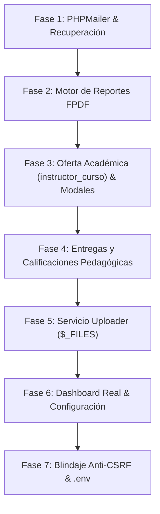

# 🚀 Guía Maestra de Implementación: Módulos y Mejoras Pendientes
**Proyecto:** DS Beauty Academy  
**Arquitectura:** PHP (PDO) / Patrón MVC / FrontController / DataTables + SweetAlert2 / FPDF / PHPMailer  
**Directorio Base:** `/opt/lampp/htdocs/proyectos/ds-beauty-academy`  
**Fecha:** Noviembre 2026  

---

## 📑 Índice de Fases

1. [Fase 1: Recuperación de Contraseñas en Login (PHPMailer)](#fase-1-recuperación-de-contraseñas-en-login-phpmailer)
2. [Fase 2: Motor de Reportes y Documentos PDF (FPDF)](#fase-2-motor-de-reportes-y-documentos-pdf-fpdf)
3. [Fase 3: Gestión de Oferta Académica (`instructor_curso`) y Modales de Admisión](#fase-3-gestión-de-oferta-académica-instructor_curso-y-modales-de-admisión)
4. [Fase 4: Flujo Pedagógico de Entregas y Calificaciones (`entregas_evaluaciones`)](#fase-4-flujo-pedagógico-de-entregas-y-calificaciones-entregas_evaluaciones)
5. [Fase 5: Servicio Centralizado de Subida de Archivos Físicos (`$_FILES`)](#fase-5-servicio-centralizado-de-subida-de-archivos-físicos-_files)
6. [Fase 6: Métricas Reales en el Dashboard y Módulo de Configuración](#fase-6-métricas-reales-en-el-dashboard-y-módulo-de-configuración)
7. [Fase 7: Blindaje de Seguridad (Anti-CSRF y Variables de Entorno)](#fase-7-blindaje-de-seguridad-anti-csrf-y-variables-de-entorno)

---

## Fase 1: Recuperación de Contraseñas en Login (PHPMailer)

### 1.1. Objetivo
Permitir a los usuarios que olvidaron su contraseña solicitar un enlace de restablecimiento seguro a su correo electrónico mediante PHPMailer.

### 1.2. Esquema de Base de Datos para Tokens
Ejecutar la siguiente sentencia SQL para gestionar los tokens con expiración:

```sql
CREATE TABLE IF NOT EXISTS password_resets (
    id_reset INT PRIMARY KEY AUTO_INCREMENT,
    email VARCHAR(150) NOT NULL,
    token VARCHAR(64) NOT NULL UNIQUE,
    expiracion DATETIME NOT NULL,
    creado_en TIMESTAMP DEFAULT CURRENT_TIMESTAMP,
    INDEX idx_token (token),
    INDEX idx_email (email)
) ENGINE=InnoDB DEFAULT CHARSET=utf8mb4 COLLATE=utf8mb4_unicode_ci;
```

### 1.3. Helper de Correo (`src/Helpers/MailerHelper.php`)
Crear una clase utilitaria que configure la instancia de `PHPMailer`:

```php
<?php
namespace DsBeautyAcademy\Helpers;

use PHPMailer\PHPMailer\PHPMailer;
use PHPMailer\PHPMailer\Exception;

class MailerHelper
{
    public static function enviarCorreo($destinatario, $nombreDestinatario, $asunto, $cuerpoHtml)
    {
        $mail = new PHPMailer(true);
        try {
            // Configuración SMTP (Adaptable a Mailtrap, Gmail o servidor SMTP local)
            $mail->isSMTP();
            $mail->Host       = 'smtp.gmail.com'; // O mailpit / mailtrap para desarrollo
            $mail->SMTPAuth   = true;
            $mail->Username   = 'tu-correo@gmail.com';
            $mail->Password   = 'tu-contrasena-de-aplicacion';
            $mail->SMTPSecure = PHPMailer::ENCRYPTION_STARTTLS;
            $mail->Port       = 587;
            $mail->CharSet    = 'UTF-8';

            // Remitente y Destinatario
            $mail->setFrom('no-reply@beautyacademy.com', 'DS Beauty Academy');
            $mail->addAddress($destinatario, $nombreDestinatario);

            // Contenido
            $mail->isHTML(true);
            $mail->Subject = $asunto;
            $mail->Body    = $cuerpoHtml;

            $mail->send();
            return true;
        } catch (Exception $e) {
            error_log("Error al enviar correo: {$mail->ErrorInfo}");
            return false;
        }
    }
}
```

### 1.4. Flujo en `LoginController.php` y Vistas
1. **Acción `solicitar_recuperacion`:**
   - Valida que el email exista en `usuarios`.
   - Genera un token aleatorio seguro: `bin2hex(random_bytes(32))`.
   - Guarda el token con expiración de 30 minutos: `DATE_ADD(NOW(), INTERVAL 30 MINUTE)`.
   - Envía el correo con una plantilla HTML conteniendo el enlace: `https://tusitio/?url=login&action=reset&token=...`.
2. **Acción `cambiar_password`:**
   - Verifica que el token exista y `expiracion > NOW()`.
   - Recibe la nueva contraseña, la encripta con `password_hash($nueva_pass, PASSWORD_BCRYPT)` y actualiza la tabla `usuarios`.
   - Elimina el token utilizado de `password_resets`.
3. **Interfaz en `src/views/login/login.php`:**
   - Añadir enlace "¿Olvidaste tu contraseña?" debajo del input de password.
   - Integrar un modal SweetAlert2 o modal estilizado con el tema *Dark Luxury* para pedir el email y enviar la petición por AJAX sin recargar la página.

---

## Fase 2: Motor de Reportes y Documentos PDF (FPDF)

### 2.1. Objetivo
Generar reportes administrativos, financieros, listas académicas y los certificados digitales oficiales de graduación en formato PDF.

### 2.2. Instalación de FPDF
Agregar FPDF al proyecto mediante Composer:
```bash
composer require setasign/fpdf
```

### 2.3. Plantilla Base de FPDF (`src/Helpers/FpdfReport.php`)
Crear una clase que herede de `FPDF` con el membrete y pie de página corporativo:

```php
<?php
namespace DsBeautyAcademy\Helpers;

use FPDF;

class FpdfReport extends FPDF
{
    private $tituloReporte;

    public function __construct($orientacion = 'P', $unidad = 'mm', $tamano = 'Letter', $titulo = 'Reporte')
    {
        parent::__construct($orientacion, $unidad, $tamano);
        $this->tituloReporte = $titulo;
    }

    // Cabecera institucional
    public function Header()
    {
        // Barra decorativa Glow Pink
        $this->SetFillColor(232, 51, 130);
        $this->Rect(0, 0, $this->GetPageWidth(), 6, 'F');

        // Nombre de la Academia
        $this->SetFont('Arial', 'B', 16);
        $this->SetTextColor(24, 24, 28);
        $this->SetY(12);
        $this->Cell(0, 8, utf8_decode('DS BEAUTY ACADEMY'), 0, 1, 'L');

        // Título del Reporte
        $this->SetFont('Arial', '', 11);
        $this->SetTextColor(100, 100, 110);
        $this->Cell(0, 6, utf8_decode($this->tituloReporte), 0, 1, 'L');

        // Fecha de emisión
        $this->SetY(12);
        $this->SetFont('Arial', '', 9);
        $this->Cell(0, 6, 'Fecha: ' . date('d/m/Y h:i A'), 0, 1, 'R');

        $this->Ln(6);
        $this->SetDrawColor(220, 220, 225);
        $this->Line(10, $this->GetY(), $this->GetPageWidth() - 10, $this->GetY());
        $this->Ln(6);
    }

    // Pie de página
    public function Footer()
    {
        $this->SetY(-15);
        $this->SetFont('Arial', 'I', 8);
        $this->SetTextColor(120, 120, 130);
        $this->Cell(0, 10, utf8_decode('Página ') . $this->PageNo() . ' / {nb} - DS Beauty Academy ERP', 0, 0, 'C');
    }
}
```

### 2.4. Controlador de Reportes (`src/Controllers/ReporteController.php`)
1. **Ruteo:** Dar de alta `ReporteController.php` para la ruta `?url=reporte`.
2. **Tipos de Reportes a Implementar:**
   - **`tipo=caja`:** Conciliación de pagos filtrados por fecha o banco (Referencia, Alumno, Monto, Estatus Verificado/Rechazado, Total recaudado).
   - **`tipo=matriculas`:** Listado de inscripciones por curso (Estudiante, Cédula, Estatus Cupo, Deudora/Solvente).
   - **`tipo=calificaciones`:** Resumen pedagógico por instructor (Alumnas, Entregas, Nota promedio, Certificación).
3. **Descarga de Certificado Digital (`?url=certificado&action=pdf&id=X`):**
   - Maquetar el certificado en formato horizontal (`Landscape`).
   - Incluir bordes ornamentales, nombre del estudiante en tipografía destacada, horas de formación del curso, serial único y fecha de expedición.

### 2.5. Vista de Reportes (`src/views/reporte/reporte.php`)
- Panel interactivo con filtros: Selector de tipo de reporte, rango de fechas (`desde` / `hasta`), y selector de curso o banco.
- Botones de acción: "Generar Vista Previa" y "Descargar PDF" que abran el documento en una pestaña nueva (`target="_blank"`).

---

## Fase 3: Gestión de Oferta Académica (`instructor_curso`) y Modales de Admisión

### 3.1. Oferta Académica (`instructor_curso`)
Es el nexo del sistema educativo: relaciona qué docente dicta qué curso.
1. **Crear `InstructorCursoModel.php`:**
   - Métodos para asignar, listar con nombres (`JOIN instructores`, `JOIN cursos`), actualizar y desvincular.
2. **Crear `InstructorCursoController.php`:**
   - Responder vía JSON para consumo asíncrono.
3. **Reemplazo en Modales de Clases y Evaluaciones:**
   - Modificar `claseModalCrear.php` y `evaluacionModalCrear.php`.
   - Reemplazar `<input type="number" name="id_instructor_curso">` por:
     ```html
     <div class="form-group mb-3">
         <label class="form-label">Curso e Instructor Asignado</label>
         <select name="id_instructor_curso" id="select_instructor_curso" class="form-control" required>
             <option value="">-- Seleccione una asignación académica --</option>
         </select>
     </div>
     ```
   - Poblar este `<select>` mediante AJAX al abrir el modal.

### 3.2. Modal para Nueva Matrícula (`matriculaModalCrear.php`)
Actualmente `matricula.php` solo lista registros.
1. Crear el componente `src/views/matricula/components/modales/matriculaModalCrear.php`.
2. Incluir campos:
   - `<select name="id_estudiante">`: Lista de estudiantes activos.
   - `<select name="id_instructor_curso">`: Lista de cursos activos con instructor y precio referencial.
   - `<input type="number" step="0.01" name="precio_acordado">`: Precio pactado (permite promociones o preventa).
   - `<select name="estatus_cupo">`: `'Reservado'` o `'Confirmado'`.
3. Conectar el envío del formulario al endpoint `POST ?url=matricula` con `guardar='true'`, capturando las excepciones del trigger `trg_matricula_check_cupo` si el aforo está lleno.

### 3.3. Modal para Registrar Pago Manual (`pagoModalCrear.php`)
1. Crear el componente `src/views/pago/components/modales/pagoModalCrear.php`.
2. Campos requeridos:
   - `<select name="id_matricula">`: Matrícula asociada (busca por cédula o nombre de estudiante).
   - `<select name="id_banco">`: Banco receptor de los fondos.
   - `<input type="text" name="referencia_transaccion">`: Código de referencia bancaria.
   - `<input type="number" step="0.01" name="monto">`: Monto cancelado.
   - `<input type="date" name="fecha_pago">`: Fecha de la operación.
   - `<input type="file" name="comprobante_archivo">`: Captura física del comprobante.

---

## Fase 4: Flujo Pedagógico de Entregas y Calificaciones (`entregas_evaluaciones`)

### 4.1. Controlador `EntregaEvaluacionController.php`
Crear el controlador para gestionar el ciclo de vida de las tareas:
1. `guardar`: Estudiante envía su asignación (`id_evaluacion`, `id_matricula`, `comentarios_estudiante`, archivo adjunto). Estatus inicial: `'Pendiente'`.
2. `calificar`: La docente asigna `calificacion_entrega` (ej. 0 a 100), `feedback_instructora_entrega` y estatus `'Aprobada'` o `'Reprobada'`.
3. Al guardar como `'Aprobada'`, el motor MySQL ejecuta el trigger `trg_entregas_completadas` y emite el certificado si el pensum fue completado.

### 4.2. Vistas y Modales de Calificación
1. **Modal de Calificación (Vista de Docente):**
   - Muestra el enlace o vista previa del trabajo entregado por la alumna.
   - Formulario para asignar nota y redactar comentarios de mejora.
2. **Componente DataTable de Entregas:**
   - Tabla que lista las entregas pendientes de revisión con badges de estado (`Pendiente`, `Aprobada`, `Reprobada`).

---

## Fase 5: Servicio Centralizado de Subida de Archivos Físicos (`$_FILES`)

### 5.1. Helper de Almacenamiento (`src/Helpers/Uploader.php`)
Evitar la dispersión de código de subida creando una clase especializada:

```php
<?php
namespace DsBeautyAcademy\Helpers;

use Exception;

class Uploader
{
    private const UPLOAD_BASE = __DIR__ . '/../../uploads/';
    private const MAX_SIZE = 5242880; // 5 MB

    public static function subir($archivo, $subcarpeta, $tiposPermitidos = ['image/jpeg', 'image/png', 'application/pdf'])
    {
        if (!isset($archivo) || $archivo['error'] !== UPLOAD_ERR_OK) {
            throw new Exception("Error al recibir el archivo en el servidor.");
        }

        if ($archivo['size'] > self::MAX_SIZE) {
            throw new Exception("El archivo excede el tamaño máximo permitido (5 MB).");
        }

        $finfo = finfo_open(FILEINFO_MIME_TYPE);
        $mime = finfo_file($finfo, $archivo['tmp_name']);
        finfo_close($finfo);

        if (!in_array($mime, $tiposPermitidos)) {
            throw new Exception("Tipo de archivo no autorizado ({$mime}).");
        }

        $extension = pathinfo($archivo['name'], PATHINFO_EXTENSION);
        $nombreUnico = uniqid('file_', true) . '.' . strtolower($extension);

        $destinoCarpeta = self::UPLOAD_BASE . trim($subcarpeta, '/') . '/';
        if (!is_dir($destinoCarpeta)) {
            mkdir($destinoCarpeta, 0755, true);
        }

        $rutaFinal = $destinoCarpeta . $nombreUnico;
        if (!move_uploaded_file($archivo['tmp_name'], $rutaFinal)) {
            throw new Exception("No se pudo guardar el archivo en el disco.");
        }

        // Retorna la ruta relativa para persistir en la BD
        return 'uploads/' . trim($subcarpeta, '/') . '/' . $nombreUnico;
    }
}
```

### 5.2. Actualización de Controladores
Reemplazar la lectura de `$_POST['url_...']` por la llamada a `Uploader::subir($_FILES['archivo'], 'subcarpeta')` en:
- `ComprobantePagoController.php` (`uploads/comprobantes/`).
- `RecursoController.php` (`uploads/recursos/`).
- `EntregaEvaluacionController.php` (`uploads/entregas/`).

---

## Fase 6: Métricas Reales en el Dashboard y Módulo de Configuración

### 6.1. Consultas SQL Reales en `DashboardModel.php`
Reemplazar los arrays estáticos por consultas directas a la base de datos:

1. **`getStatistics()`:**
   ```php
   public function getStatistics()
   {
       // Estudiantes activos
       $stmt1 = $this->con->query("SELECT COUNT(*) FROM estudiantes WHERE estatus_estudiante = 'Activo'");
       $totalEstudiantes = $stmt1->fetchColumn();

       // Ingresos totales del mes en curso
       $stmt2 = $this->con->query("SELECT COALESCE(SUM(monto), 0) FROM comprobante_pagos WHERE estatus_comprobante = 'Verificado' AND MONTH(fecha_pago) = MONTH(CURRENT_DATE()) AND YEAR(fecha_pago) = YEAR(CURRENT_DATE())");
       $ingresosMes = $stmt2->fetchColumn();

       // Cursos activos actualmente
       $stmt3 = $this->con->query("SELECT COUNT(*) FROM cursos WHERE estatus_curso = '1'");
       $totalCursos = $stmt3->fetchColumn();

       // Instructores registrados
       $stmt4 = $this->con->query("SELECT COUNT(*) FROM instructores WHERE estatus_instructor = 'Activo'");
       $totalInstructores = $stmt4->fetchColumn();

       return [
           'estudiantes_activos'     => number_format($totalEstudiantes),
           'ingresos_mensuales'      => '$' . number_format($ingresosMes, 2),
           'ingresos_tendencia'      => 'up',
           'cursos_en_curso'         => (string)$totalCursos,
           'progreso_cursos'         => 80,
           'instructores_registrados'=> (string)$totalInstructores
       ];
   }
   ```
2. **`getRecentEnrollments()`:** Conectar con un `JOIN` entre `matriculas`, `estudiantes` y `cursos` ordenado por `id_matricula DESC LIMIT 6`.
3. **`getUpcomingPayments()`:** Consultar comprobantes pendientes de conciliación (`estatus_comprobante = 'Pendiente'`).

### 6.2. Módulo de Configuración (`?url=configuracion`)
1. Crear `ConfiguracionModel.php`, `ConfiguracionController.php` y `src/views/configuracion/configuracion.php`.
2. Tabla `configuracion_sistema` para almacenar: Nombre comercial, teléfono, dirección física, RIF, correo de contacto y moneda base.

---

## Fase 7: Blindaje de Seguridad (Anti-CSRF y Variables de Entorno)

### 7.1. Variables de Entorno (`.env`)
1. Instalar `vlucas/phpdotenv` vía Composer:
   ```bash
   composer require vlucas/phpdotenv
   ```
2. Crear `.env` en la raíz (e ignorarlo en `.gitignore`):
   ```env
   DB_HOST=localhost
   DB_NAME=ds_beauty_academy_db
   DB_USER=root
   DB_PASS=
   DB_CHARSET=utf8mb4
   APP_ENV=local
   ```
3. Actualizar `src/config/components/configSystem.php` para cargar variables con `Dotenv::createImmutable(__DIR__ . '/../../..')->load()`.

### 7.2. Tokens Anti-CSRF
1. Generar token de sesión en el arranque si no existe:
   ```php
   if (empty($_SESSION['csrf_token'])) {
       $_SESSION['csrf_token'] = bin2hex(random_bytes(32));
   }
   ```
2. En `src/assets/js/helpers/ajax.js`, adjuntar automáticamente el token en cada petición POST:
   ```javascript
   data.append('csrf_token', window.csrfToken);
   ```
3. Validar en `FrontController.php` que las peticiones POST contengan un token idéntico a `$_SESSION['csrf_token']`.

---

## 📅 Matriz de Secuencia de Implementación Sugerida


