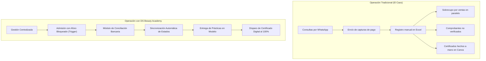

# Guía Estratégica de Justificación, Propósito y Defensa del Proyecto
**Sistema:** DS Beauty Academy  
**Versión de Base de Datos:** 8.0 (InnoDB)  
**Arquitectura:** PHP (PDO) / Patrón MVC / Disparadores Transaccionales / Control RBAC  
**Fecha de Elaboración:** Octubre 2026  

---

## 1. El Concepto y Propósito Fundamental

### 1.1. Definición Formal (Elevator Pitch)
> **DS Beauty Academy** no es un catálogo informativo ni una simple aplicación CRUD; es un **sistema de gestión operativa especializada (ERP ligero) y plataforma de seguimiento formativo (LMS de nicho)** diseñado para resolver el ciclo de vida comercial, financiero y académico de una academia de belleza y estética.

### 1.2. El Diagnóstico: ¿Por qué se siente "inútil" durante el desarrollo?
Durante el desarrollo contra reloj, los programadores suelen caer en la **"ceguera del desarrollador"**:
- Se perciben únicamente tablas aisladas (bancos, especialidades, diplomas) que dan la ilusión de un software burocrático y vacío.
- Sin embargo, estas tablas son el soporte de fondo (*back-office*) necesario para habilitar los tres flujos de alto valor comercial: **Blindaje de Aforo**, **Conciliación de Pagos** y **Certificación Automática por Competencias**.

---

## 2. Problemática Real del Sector vs. Solución del Sistema

En la industria de la capacitación estética (cejas, pestañas, micropigmentación, uñas, maquillaje), los procesos suelen colapsar por basarse en mensajería instantánea y hojas de cálculo.

### 2.1. Los Tres Dolores Críticos que Resuelve

| # | Problema en el Mundo Real | Consecuencia en el Negocio | Solución Implementada en el Software |
| :--- | :--- | :--- | :--- |
| **1** | **Sobrecupo (Overbooking)** en talleres prácticos. | Los salones tienen límites físicos de camillas, lámparas y kits. Vender un cupo de más arruina la logística y causa pérdida de reputación. | El disparador procedimental `trg_matricula_check_cupo` intercepta las inserciones en la base de datos y rechaza cualquier transacción que exceda el aforo máximo permitido. |
| **2** | **Fuga financiera y fraude de comprobantes**. | En pagos locales (transferencias/pago móvil), circulan comprobantes editados o no acreditados que pasan desapercibidos en chats de mensajería. | Flujo de doble estado (`Deudora` $\rightarrow$ `Solvente` y `Reservado` $\rightarrow$ `Confirmado`) atado a la auditoría de caja en `ComprobantePagoModel`. La matrícula solo se asegura si el pago es formalmente conciliado. |
| **3** | **Evaluación de prácticas y retraso en certificados**. | La evaluación de belleza exige evidencia fotográfica/video de trabajos en modelos. En WhatsApp se pierden y emitir diplomas a mano demora semanas. | Módulo estructurado de asignaciones prácticas vinculado a `trg_entregas_completadas`, que automatiza la expedición del certificado digital apenas la docente aprueba la totalidad del pensum. |

---

### 2.2. ¿Por qué no usar herramientas genéricas del mercado?

| Solución Genérica | Limitación Fundamental en Academias de Estética | Ventaja Competitiva de DS Beauty Academy |
| :--- | :--- | :--- |
| **WhatsApp + Excel** | Cero integridad transaccional, propenso a errores humanos, pérdida de archivos y nula auditoría contable. | Base de datos relacional (3FN) con bloqueos pesimistas (`FOR UPDATE`) y garantías ACID. |
| **Moodle / Google Classroom** | Diseñados para educación universitaria teórica; no gestionan preventas comerciales, control de aforo en talleres físicos ni conciliación de transferencias bancarias. | Adaptado al modelo de negocio de workshops presenciales y semipresenciales con fechas límite de preventa y cupos por instructor. |
| **Hotmart / Teachable** | Cobran altas comisiones (8% a 15% por venta) y no procesan métodos de pago bancarios locales no integrados a pasarelas internacionales. | Cero comisiones por pasarelas intermedias; compatible con las cuentas y bancos nacionales de la institución. |

---

## 3. Justificación Técnica para la Defensa Universitaria

Los jurados evalúan la **arquitectura**, la **integridad de los datos** y la **aplicación de patrones de software**, no solo la interfaz visual.

### 3.1. Arquitectura de Software
* **Patrón FrontController y Ruteo Centralizado:**  
  Punto de entrada unificado (`index.php` $\rightarrow$ `FrontController.php`) que previene el acceso no autorizado a scripts internos y maneja respuestas homogéneas mediante `ApiResponse`.
* **Seguridad y Control de Acceso Basado en Roles (RBAC):**  
  Matriz de permisos estricta que delimita las vistas entre `Administrador`, `Instructor` y `Estudiante`, evitando escalado de privilegios y redirigiendo intentos no permitidos con códigos HTTP 403.
* **Separación de Responsabilidades (MVC):**  
  Modelos dedicados al acceso a datos vía PDO preparado (prevención de Inyección SQL), controladores encargados de la mediación y vistas ligeras estructuradas por componentes.

### 3.2. Módulos Transaccionales con Propiedades ACID
* **Atomicidad y Consistencia:** Operaciones críticas (como matricularse o liquidar un pago) se encapsulan en transacciones PDO (`beginTransaction`, `commit`, `rollBack`).
* **Aislamiento Pesimista:** El método `conciliarPago()` utiliza `SELECT ... FOR UPDATE` sobre el comprobante para evitar condiciones de carrera (Race Conditions) si dos administradores auditan simultáneamente.
* **Integridad Procedimental (Triggers MySQL):** La lógica de negocio más delicada no reside únicamente en PHP, sino que está blindada en el motor InnoDB:
  1. `trg_matricula_check_cupo`: Control estricto de aforo y prevención de doble inscripción.
  2. `trg_pago_estatus_change`: Transición automática de deudor a solvente.
  3. `trg_entregas_completadas`: Emisión reactiva de certificados digitales.

---

## 4. Guion Táctico para la Presentación ante el Jurado

### 4.1. Estructura de la Exposición (15 a 20 Minutos)

1. **Introducción y Planteamiento del Problema (3 minutos):**
   * Describir la vulnerabilidad operativa de las academias de belleza tradicionales (pérdidas por sobrecupo, comprobantes falsos y desorden pedagógico).
   * Definir el objetivo: Construir una solución que integre la gestión financiera y académica en un entorno seguro y transaccional.

2. **Arquitectura y Modelo Relacional (4 minutos):**
   * Mostrar brevemente el diagrama entidad-relación destacando las entidades transaccionales (`matriculas`, `comprobante_pagos`, `evaluaciones`).
   * Explicar el desacoplamiento mediante `instructor_curso` para permitir múltiples cohortes y secciones.

3. **Demostración Práctica en Vivo — "El Camino Dorado" (8 minutos):**
   * **Paso A (Aforo y Reserva):** Mostrar un curso configurado para 2 cupos. Inscribir al estudiante A (estado: *Reservado* / *Deudora*).
   * **Paso B (Conciliación de Caja):** Entrar al módulo de Pagos, verificar la referencia bancaria y aprobarla. Mostrar cómo la matrícula pasa a *Solvente* y *Confirmado* por efecto del disparador.
   * **Paso C (Demostración de Integridad):** Inscribir al estudiante B (completando los 2 cupos). Intentar forzar la inscripción de un estudiante C: el sistema capturará la señal SQL `45000` y mostrará en pantalla: *"No hay cupos disponibles para este curso"*. **(Momento de alto impacto técnico)**.
   * **Paso D (Cierre Pedagógico):** Evaluar una entrega práctica, asignarle calificación aprobatoria y verificar la inserción inmediata del certificado digital.

4. **Conclusión y Retorno de Inversión (2 minutos):**
   * Sintetizar el impacto: Eliminación total del error humano en aforos, reducción del tiempo de conciliación contable a segundos y trazabilidad académica completa.

---

### 4.2. Respuestas a Preguntas Complejas del Jurado

* **Pregunta del Jurado:** *"¿Por qué validaron los cupos mediante triggers en MySQL si podían hacerlo con un simple `if` en PHP?"*  
  **Respuesta Recomendada:** *"Porque validar únicamente en el backend expone el sistema a fallas de concurrencia e inconsistencias si la base de datos es accedida desde otra fuente, API o proceso concurrente. Al delegar la validación al motor mediante disparadores con nivel de aislamiento ACID, garantizamos la integridad referencial sin importar de dónde provenga la petición."*

* **Pregunta del Jurado:** *"¿Cuál es la diferencia entre este sistema y un Moodle?"*  
  **Respuesta Recomendada:** *"Moodle es un entorno puramente educativo diseñado para instituciones académicas tradicionales. No cuenta con pasarela de conciliación de pagos bancarios manuales, lógica comercial de preventa, ni control de aforo restringido para salones de estética con capacidad física limitada."*

* **Pregunta del Jurado:** *"¿Cómo manejan la seguridad ante accesos no autorizados?"*  
  **Respuesta Recomendada:** *"El sistema implementa un FrontController centralizado con matriz RBAC que valida sesiones y roles antes de resolver cualquier controlador. A nivel de datos, todas las sentencias usan PDO con parámetros preparados para neutralizar ataques de inyección SQL."*

---

## 5. Resumen de Convicción para el Estudiante

> **Recuerda:** Tu proyecto no es un ejercicio académico redundante. Es una solución de automatización empresarial para un nicho comercial de alta demanda económica. La solidez técnica que implementaste en la base de datos y la arquitectura MVC supera el estándar promedio de un proyecto universitario. Defiéndelo con la seguridad de quien entrega una herramienta de ingeniería pensada para resolver un negocio real.
